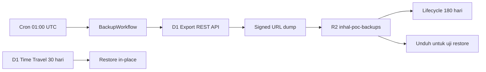

# Desain Backup dan Pemulihan D1 (Poin 2)

Tanggal: 2026-10-17
Status: disetujui secara desain, menunggu aktivasi R2.

## Tujuan

- Menyediakan pemulihan cepat untuk kesalahan data atau migrasi melalui D1 Time Travel.
- Menyimpan arsip harian berumur 180 hari di Cloudflare R2 untuk pemulihan jangka panjang.
- Membuktikan bahwa arsip dapat diunduh, diimpor, dan diverifikasi, bukan hanya dibuat.
- Mendokumentasikan prosedur restore yang dapat dijalankan operator lain.

## Non-tujuan

- Replikasi real-time atau read replica.
- Backup berkas upload di luar D1 (berkas disimpan sebagai base64 di D1).
- Alerting dan dashboard observability (menjadi Poin 3).
- Multi-region failover.

## Kondisi saat ini

- Database: D1 `inhal-poc` (`8f412848-d213-4bb3-aeb7-0aff221f9ee3`), region APAC.
- Worker: `inhal-form`, konfigurasi di `new-code1-cf/wrangler.toml`.
- Time Travel D1 aktif otomatis; jendela restore 30 hari (Workers Paid) atau 7 hari (Workers Free).
- Belum ada backup terjadwal, retensi, atau SOP restore.
- R2 belum diaktifkan pada akun Cloudflare per 2026-10-17.

## Keputusan desain

1. Time Travel adalah jalur pemulihan utama untuk insiden dalam 30 hari.
2. Arsip R2 adalah lapisan retensi panjang dan bahan uji restore.
3. Ekspor dijalankan oleh Cloudflare Workflow harian, bukan Cron Trigger biasa, agar polling dan retry ditangani platform.
4. Retensi 180 hari dikelola lifecycle rule R2, bukan kode penghapusan.
5. Tidak ada endpoint HTTP baru; Workflow hanya dipicu jadwal.

## Arsitektur



Komponen:

- `src/backup/export.js`: helper murni untuk memulai ekspor, polling, penyimpanan R2, dan manifest. Menerima `fetchImpl` agar mudah diuji.
- `src/backup/workflow.js`: kelas `BackupWorkflow` yang mengorkestrasi langkah Workflow.
- `src/index.js`: mengekspor ulang `BackupWorkflow` agar dikenali konfigurasi Wrangler.
- `scripts/verify-backup.mjs`: mengimpor dump ke SQLite lokal dan menjalankan pemeriksaan integritas.
- `wrangler.toml`: binding Workflow, R2, jadwal, dan variabel non-rahasia.
- `docs/ops/backup-restore.md`: SOP backup, restore, dan uji berkala.

## Alur ekspor

1. Workflow dimulai oleh jadwal `0 1 * * *`.
2. Langkah `start-export` memanggil:
   `POST /accounts/{accountId}/d1/database/{databaseId}/export`
   dengan `{ "output_format": "polling" }`.
3. Respons harus memuat `result.at_bookmark`; jika tidak, langkah gagal dan diulang.
4. Langkah polling memanggil endpoint yang sama dengan `{ "current_bookmark": bookmark }`.
5. Jika `result.signed_url` belum ada, Workflow tidur 10 detik lalu polling lagi, maksimal 30 kali.
6. Setelah `signed_url` tersedia, unduh dump, hitung SHA-256, lalu simpan:
   - `d1/YYYY-MM-DDTHH-mm-ssZ.sql`
   - `d1/YYYY-MM-DDTHH-mm-ssZ.json`
7. Manifest berisi:

```json
{
  "database": "inhal-poc",
  "databaseId": "8f412848-d213-4bb3-aeb7-0aff221f9ee3",
  "bookmark": "000001b7-...",
  "filename": "d1/2026-10-18T01-00-05Z.sql",
  "bytes": 363000,
  "sha256": "...",
  "startedAt": "2026-10-18T01:00:00.000Z",
  "finishedAt": "2026-10-18T01:00:20.000Z"
}
```

8. Prefix `d1/` memiliki lifecycle rule `expire-days = 180`.

## Penanganan kegagalan

- Setiap langkah memakai retry Workflow dengan batas dan backoff eksplisit.
- Polling yang melewati 30 percobaan melempar error.
- Respons API non-2xx atau tanpa `signed_url` dianggap gagal.
- Sebelum melempar error akhir, Workflow menulis `status/last-failure.json` berisi waktu, langkah, dan pesan error.
- Keberhasilan menulis `status/last-success.json`.
- Kegagalan juga terlihat di halaman Workflows Cloudflare dan log Worker.
- Status di R2 tidak menggantikan alerting; alerting masuk Poin 3.

## Keamanan

- `D1_REST_API_TOKEN` disimpan sebagai secret Worker, tidak pernah masuk repo.
- Token sebaiknya dibuat khusus dengan izin ekspor D1 untuk database target saja.
- `ACCOUNT_ID`, `DATABASE_ID`, dan nama bucket adalah variabel non-rahasia.
- Workflow tidak membuka endpoint HTTP dan tidak menerima input pengguna.
- Dump berisi data pribadi; akses R2 dibatasi ke akun operator, tidak ada public bucket.
- Manifest tidak memuat isi data, hanya metadata.

## Retensi

- Time Travel: 30 hari (Workers Paid) atau 7 hari (Workers Free), tanpa biaya tambahan.
- R2: 180 hari sejak objek dibuat, prefix `d1/`, dikelola lifecycle rule.
- Status disimpan di prefix `status/`, di luar prefix `d1/`, sehingga tidak ikut lifecycle 180 hari; hanya satu objek terbaru per status.

## Pemulihan

### Time Travel (insiden dalam jendela retensi)

1. Hentikan operasi tulis bila memungkinkan.
2. Catat bookmark saat ini:
   `wrangler d1 time-travel info inhal-poc`
3. Tentukan timestamp kejadian dan ambil bookmark-nya:
   `wrangler d1 time-travel info inhal-poc --timestamp="<ISO-8601>"`
4. Restore:
   `wrangler d1 time-travel restore inhal-poc --bookmark=<bookmark>`
5. Simpan bookmark undo yang dicetak perintah restore.
6. Verifikasi: health check, login admin, jumlah pengajuan, audit integritas master.
7. Catat insiden dan hasilnya.

Restore Time Travel bersifat destruktif dan menimpa database. Jangan diuji pada produksi tanpa persetujuan.

### Arsip R2

1. Unduh dump terbaru dari R2.
2. Impor ke SQLite lokal:
   `node scripts/verify-backup.mjs <file.sql>`
3. Skrip memeriksa:
   - `PRAGMA integrity_check` = `ok`
   - tabel inti ada
   - jumlah baris tabel inti > 0
   - tidak ada duplikat `master_kegiatan`
   - tidak ada referensi blok yang tidak ada di master
4. Untuk restore produksi dari arsip, buat database D1 baru, impor dump, validasi, lalu arahkan binding `DB` ke database baru. Restore in-place dari dump tidak dipakai karena berisiko menghapus data yang lebih baru.
5. Catat hasil di `docs/ops/backup-restore.md`.

## Uji

### Unit test

- `start-export` mengirim payload polling dan mengembalikan bookmark.
- `poll-export` mengembalikan `signed_url` saat siap.
- Polling berhenti setelah batas dan melempar error.
- Respons non-2xx melempar error dengan pesan yang jelas.
- Penyimpanan menulis dump dan manifest dengan hash, ukuran, dan bookmark yang benar.
- Kegagalan menulis status kegagalan.
- Konfigurasi Wrangler memuat jadwal, binding Workflow, binding R2, dan tidak memuat token.

### Uji produksi

1. Trigger Workflow manual setelah deploy.
2. Pastikan `d1/<timestamp>.sql` dan `.json` ada di R2.
3. Unduh dump, jalankan `verify-backup.mjs`, catat hasil.
4. Pastikan lifecycle rule 180 hari aktif.
5. Catat bookmark Time Travel saat verifikasi.

## Rollout

1. Aktifkan R2 di akun Cloudflare.
2. Buat bucket privat `inhal-poc-backups`.
3. Buat token API berizin ekspor D1, simpan sebagai secret `D1_REST_API_TOKEN`.
4. Deploy Worker dengan Workflow dan binding R2.
5. Tambahkan lifecycle rule `expire-days=180` untuk prefix `d1/`.
6. Trigger manual dan verifikasi objek.
7. Jalankan uji restore lokal dan catat.
8. Aktifkan jadwal harian (sudah aktif saat deploy).

## Kriteria selesai

- Workflow harian berjalan dan menghasilkan dump + manifest di R2.
- Retensi 180 hari aktif.
- Uji restore lokal lulus dengan dump produksi.
- Tidak ada token atau kredensial di repo.
- SOP backup/restore tersedia dan sudah dijalankan minimal sekali.
- Time Travel bookmark terdokumentasi.

## Risiko dan catatan

- R2 belum aktif; seluruh rollout menunggu aktivasi.
- Workflows pada Workers Free memiliki batas CPU 10 ms per langkah; dump kecil saat ini, tetapi perlu dipantau bila database tumbuh besar.
- Token API yang terlalu luas meningkatkan dampak bila bocor; gunakan token terbatas.
- Lifecycle R2 hanya menghapus objek, bukan versi lama; bucket tidak memakai versioning.
- Jika dump berisi data sensitif, unduhan lokal harus disimpan di perangkat terkontrol dan dihapus setelah verifikasi.
