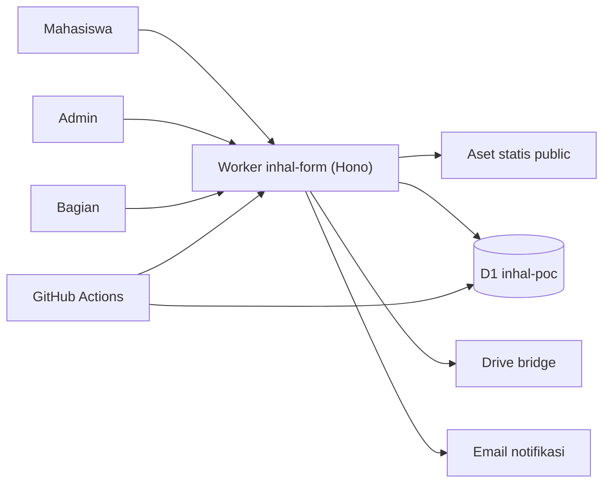
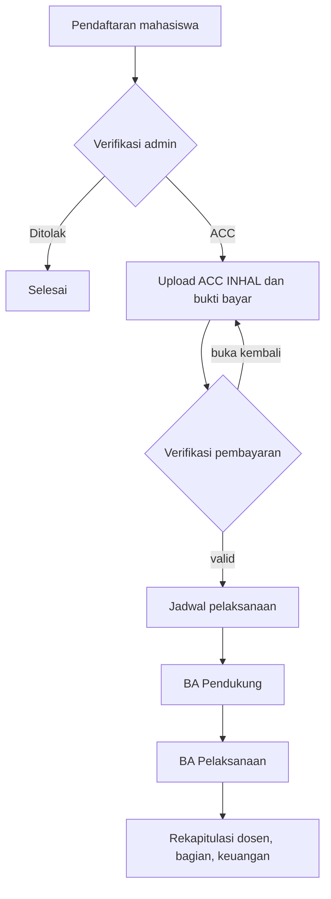
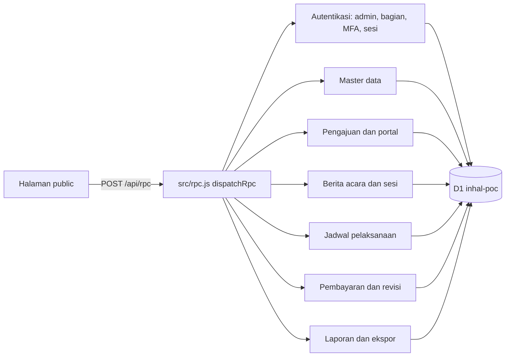
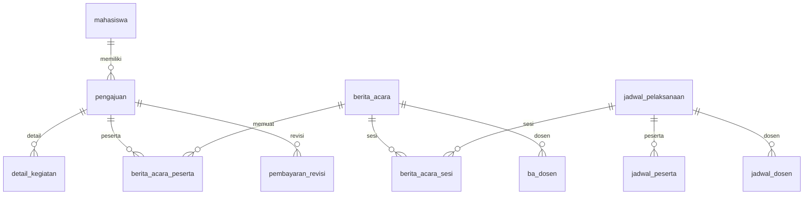
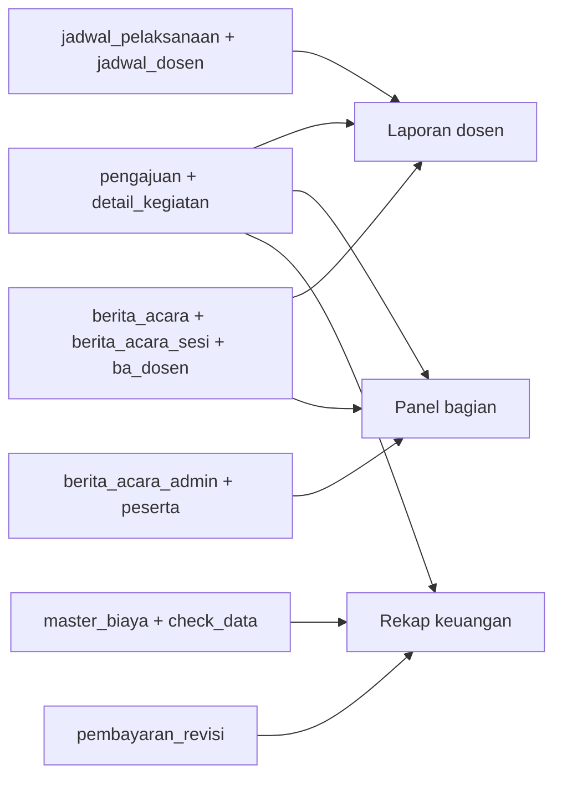

# INHAL Dashboard (Cloudflare Workers)

Aplikasi pendaftaran dan pelaporan kegiatan INHAL: portal mahasiswa, panel admin,
panel bagian, jadwal pelaksanaan, berita acara (pendukung dan pelaksanaan),
verifikasi pembayaran, serta rekapitulasi dosen, bagian, dan keuangan.

Aplikasi berjalan di Cloudflare Workers dengan Hono. Data utama disimpan di D1.
Berkas (surat keterangan, ACC INHAL, bukti bayar, berita acara) disimpan di Google
Drive melalui bridge Apps Script. Google Sheets hanya dipakai untuk impor data awal.

## Komponen

| Komponen | Nama resource | Keterangan |
|---|---|---|
| Worker produksi | `inhal-form` | Melayani halaman dan API produksi |
| Worker staging | `inhal-form-staging` | Uji rilis dengan D1 terpisah |
| Database | D1 `inhal-poc` | Binding `DB`, sumber data utama |
| Aset statis | `public/` | Halaman portal, dashboard, detail laporan, bagian |
| Bridge berkas | `GAS_DRIVE_URL` + secret `GAS_DRIVE_TOKEN` | Unggah dan baca berkas Drive |
| CI/CD | GitHub Actions | Test, cek CSP, guard migrasi, dry-run deploy |
| Backup | `BackupWorkflow` | Ekspor basis data terjadwal |

README ini hanya memuat nama resource. ID akun, ID database, URL internal, dan
token tidak dicantumkan.

## Arsitektur



- `src/index.js` menangani rute HTTP, header keamanan, request id, dan logging.
- `src/rpc.js` menjadi dispatcher tunggal untuk panel admin dan panel bagian.
- `src/read/*` menangani baca dan agregasi laporan; `src/write/*` menangani tulis.
- `public/*.html` adalah halaman Vue yang memanggil `POST /api/rpc` melalui
  `gs-shim.js`.

## Peran dan akses

| Peran | Halaman | Kemampuan | Autentikasi |
|---|---|---|---|
| Mahasiswa | `/portal` | Daftar, lihat status, unggah ACC INHAL dan bukti bayar | NPM |
| Admin | `/dashboard`, `/detail-laporan` | Verifikasi pengajuan, pembayaran, master data, jadwal, BA pendukung, laporan | Password + MFA + sesi |
| Bagian | `/bagian` | Jadwal, BA pelaksanaan, peserta, unggah berkas | Kategori dan sub-bagian |

- Sesi disimpan di tabel `sessions` dengan masa berlaku 4 jam.
- Login dibatasi oleh `auth_throttle` untuk mencegah percobaan berulang.
- Admin dapat mengaktifkan MFA; bila aktif, login wajib kode autentikator (`admin_mfa`).
- Semua respons memakai header keamanan dan CSP dari `src/security/headers.js`.

## Alur bisnis



- Status pengajuan: `Menunggu`, `ACC`, `Ditolak`.
- `Link Final` hanya berlaku selama status `ACC`.
- Peserta dianggap final bila `Masuk BA` (tercatat di peserta BA pelaksanaan).
- Verifikasi pembayaran dapat mencatat kesesuaian `pas`, `kurang`, atau `lebih`.
- Koreksi `buka_kembali` mengembalikan pembayaran ke `menunggu` untuk diverifikasi ulang.

## Rute HTTP

| Method | Rute | Keterangan |
|---|---|---|
| GET | `/` | Redirect ke `/portal` |
| GET | `/index.html` | Redirect ke `/portal` |
| GET | `/portal` | Portal mahasiswa |
| GET | `/dashboard` | Panel admin |
| GET | `/detail-laporan` | Laporan detail admin |
| GET | `/bagian` | Panel bagian |
| GET | `/api/health` | Cek Worker dan koneksi D1 |
| GET | `/api/registration-options` | Opsi form pendaftaran |
| GET | `/api/mahasiswa/:npm` | Nama mahasiswa |
| POST | `/api/pengajuan` | Simpan pendaftaran |
| GET | `/api/portal/:npm` | Data portal mahasiswa |
| POST | `/api/portal/upload` | Unggah ACC INHAL dan bukti bayar |
| GET | `/api/files/:id` | Ambil berkas dari bridge Drive |
| POST | `/api/rpc` | Dispatcher RPC panel admin dan bagian |
| POST | `/api/database-export` | Ekspor basis data |

## Peta fungsi



Modul utama:

- `src/index.js`: rute HTTP, portal, unggah, ekspor, health.
- `src/rpc.js`: peta `HANDLERS` untuk seluruh fungsi panel.
- `src/read/common.js`: normalisasi, kunci kegiatan, resolusi biaya, akses bagian.
- `src/read/laporan.js`: bootstrap laporan admin dan unit kegiatan.
- `src/read/dashboard.js`: statistik, daftar pengajuan, agregasi bagian.
- `src/write/beritaAcara.js`: BA pendukung, BA pelaksanaan, sesi, peserta, dosen.
- `src/write/jadwal.js`: simpan, ubah, batalkan jadwal.
- `src/write/pembayaran.js`: verifikasi dan koreksi pembayaran.

## Model data D1 ringkas

| Domain | Tabel | Fungsi |
|---|---|---|
| Identitas dan akses | `admin`, `admin_mfa`, `bagian_staff`, `sessions`, `auth_throttle` | Login, MFA, sesi, throttle |
| Master | `mahasiswa`, `master_kegiatan`, `master_bagian`, `master_biaya`, `config`, `id_sequence` | Referensi kegiatan, bagian, biaya, penomoran |
| Pendaftaran | `pengajuan`, `detail_kegiatan`, `check_data`, `status_history`, `nomor_surat` | Data pendaftar, detail kegiatan, override, riwayat status |
| Jadwal | `jadwal_pelaksanaan`, `jadwal_peserta`, `jadwal_dosen` | Jadwal aktif, peserta, dosen |
| Berita acara | `berita_acara`, `berita_acara_sesi`, `berita_acara_peserta`, `ba_dosen` | BA bagian, sesi, peserta, dosen |
| BA pendukung | `berita_acara_admin`, `berita_acara_admin_peserta`, `berita_acara_admin_berkas` | BA dari admin dan berkasnya |
| Keuangan | `master_biaya`, `check_data`, `pembayaran_revisi` | Tagihan, override biaya, riwayat revisi |
| Audit dan berkas | `audit_log`, `log_data`, `log_upload`, `uploads` | Jejak audit dan unggahan |
| Migrasi | `d1_migrations` | Riwayat migrasi D1 |

Relasi inti:



## Aturan bisnis inti

- Tagihan dihitung berurutan: override `check_data` (`BIAYA-OVERRIDE`), lalu
  `master_biaya` berdasarkan `Detail`, lalu `Jenis Kegiatan` hanya bila `Detail`
  kosong, dan `0` bila tidak ada yang cocok.
- Verifikasi pembayaran hanya untuk pengajuan `ACC`, belum `valid` atau `gratis`,
  dan `payment_revision` masih sama. Verifikasi biasa memerlukan bukti bayar.
- Kesesuaian verifikasi biasa wajib cocok dengan nominal: `pas`, `kurang`, atau
  `lebih`. `gratis` hanya untuk tagihan nol yang terdaftar di override atau
  `master_biaya`, dengan alasan wajib pada Catatan Verifikasi.
- Koreksi `administratif` tidak boleh mengubah nominal atau kesesuaian; perubahan
  nominal memakai `buka_kembali`. Alasan koreksi minimal 5 karakter. Pembayaran
  `gratis` tidak dapat dikoreksi.
- Jadwal terkunci setelah BA dibuat: ubah dan batal ditolak sampai BA dihapus.
- Satu jadwal hanya boleh ditautkan ke satu BA. Tanggal BA harus sama dengan
  tanggal sesi paling awal. Satu BA dapat memuat maksimal 50 sesi.
- BA pelaksanaan tanpa berkas dihitung `Draft`; tanpa tautan sesi dihitung 1 sesi.
- Progres unit: pendaftaran, BA pendukung, keputusan, final, pelaksanaan, selesai.
  Tahap `selesai` menuntut BA pelaksanaan yang memiliki dosen, tanggal, jam, dan berkas.

## Sistem pelaporan



- **Laporan dosen**: jumlah kegiatan yang tercatat pada BA pelaksanaan per dosen,
  beserta jumlah sesi dan jumlah peserta. Nama dosen dinormalisasi; varian yang
  sangat mirip dilaporkan sebagai peringatan, bukan digabung otomatis.
- **Panel bagian**: rekapitulasi peserta, BA pendukung, BA pelaksanaan, sesi, dan
  progres per kegiatan untuk bagian dan kategori tertentu.
- **Keuangan**: tagihan, status pembayaran, kesesuaian nominal, total diterima,
  selisih, serta riwayat revisi pembayaran. Baris `gratis` ditampilkan sebagai
  "Gratis", bukan `Rp 0`.

Rincian rumus dan sumber data: `docs/laporan.md`.

## Menjalankan lokal

Jalankan dari direktori `new-code1-cf/`:

```bash
npm install
npm run db:local
npx wrangler dev
```

Buka `http://localhost:8787`. Rute `/` diarahkan ke `/portal`.

## Test dan pemeriksaan

```bash
npm test
npm run test:local
npm run test:scripts
npm run csp:check
npm run migrations:check
```

- `npm test` menjalankan `vitest run`; path proyek tidak boleh memuat spasi.
- `npm run test:local` menyalin proyek ke mirror tanpa spasi sebelum menjalankan test.
- Repo memakai LF. Jalankan `git config core.autocrlf false` agar test CSP dan
  template tidak gagal karena CRLF.

## Deploy dan migrasi

- Migrasi memakai `npx wrangler d1 migrations list/apply`; file migrasi lama tidak
  boleh diubah.
- Staging memakai Worker `inhal-form-staging` dengan D1 terpisah.
- Produksi dideploy manual dengan approval.
- Instalasi baru menjalankan `schema.sql` saja, lalu tidak menjalankan ulang file
  di `migrations/`.

Panduan deploy: `DEPLOY.md`. Operasional: `../docs/ops/`.

## Struktur direktori

```text
new-code1-cf/
  src/            Worker: rute, RPC, baca, tulis, sesi, audit
  public/         Halaman statis dan skrip UI
  migrations/     Migrasi D1
  scripts/        Impor, seed, audit, CSP, mirror test
  test/           Test otomatis
  schema.sql      Skema instalasi baru
  wrangler.toml   Konfigurasi lokal dan staging
  wrangler.production.toml
  docs/           Arsitektur dan laporan
```

## Dokumen terkait

- `docs/arsitektur.md`: arsitektur, peta fungsi, aturan, dan operasional.
- `docs/laporan.md`: sistem pelaporan dosen, bagian, dan keuangan.
- `../docs/ops/release.md`: rilis dan staging.
- `../docs/ops/uat.md`: matriks UAT dan aksesibilitas.
- `../docs/ops/data-quality.md`: audit duplikat jadwal dan kualitas data.
